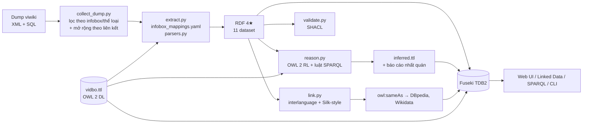

# Báo cáo dự án: ViDBpedia — xây dựng DBpedia tiếng Việt

**Đề tài 2.** *Build a DBpedia version for Vietnamese language* — định nghĩa ontology, thu thập bài viết Wikipedia tiếng Việt,
chuyển dữ liệu sang chuẩn 4★, liên kết tới DBpedia tiếng Anh, cung cấp SPARQL endpoint/terminal.

**Nhóm thực hiện:** Le Phu Tai (20252268M), Nguyen Thi Mai Anh (20252265M), Duong Hoang Hai (20252273M), Le Van Luan (20252572M) — SoICT, HUST.

---

## 1. Tổng quan

| Hạng mục | Kết quả |
|---|---|
| Miền tri thức | Lịch sử – địa lý – danh nhân Việt Nam (vua chúa, quan lại, tướng lĩnh, chính khách, nhà văn; triều đại, quốc gia; đơn vị hành chính sau cải cách 2025; chiến tranh, trận đánh; tác phẩm) |
| Nguồn | Dump Wikipedia tiếng Việt ngày 01/10/2026 (1,62 triệu bài) + bảng `langlinks`, `page_props` |
| Bài viết được trích xuất | 44.003 bài (43.614 bài sau khi loại 389 trang định hướng) |
| Ontology `vidbo` | 48 lớp, 67 object property, 48 datatype property; 13 lớp định nghĩa, 10 property chain, 7 thuộc tính bắc cầu, 18 cặp nghịch đảo, 8 nhóm lớp rời nhau, `hasKey`; 53 tiên đề căn chỉnh với DBpedia/FOAF/schema.org |
| Triple trích xuất (4★) | 1.511.725 triple trong 12 dataset (trong đó 626.995 triple “lõi”: kiểu, quan hệ, thuộc tính, nhiệm kỳ) |
| Triple suy diễn | 2.636.065 triple (≈ 4,2 lần số triple lõi) |
| Liên kết `owl:sameAs` tới DBpedia | 32.136 tới DBpedia qua interlanguage link (đã xác minh, 937 đi qua redirect) + 329 do bộ so khớp kiểu Silk; 43.145 tới Wikidata |
| Endpoint | Apache Jena Fuseki 5.6 (TDB2, 4 named graph) + Web UI Flask + CLI |

Kiến trúc pipeline (giống DBpedia Extraction Framework):



---

## 2. Ontology `vidbo` (phần trọng tâm)

### 2.1 Phương pháp

* **Grüninger & Fox** (slide 07): kịch bản → 18 *competency question* ([docs/competency_questions.md](competency_questions.md))
  → thuật ngữ → câu hỏi hình thức (SPARQL, [queries/](../queries/)) → tiên đề. Mỗi tiên đề tồn tại vì có ít nhất một câu hỏi cần nó.
* **Dựa trên dữ liệu thật:** trước khi viết ánh xạ, thống kê tần suất tham số của từng bản mẫu infobox trên toàn bộ dữ liệu
  (ví dụ phát hiện 492 bài dùng `Infobox officeholder 1`, 555 bài dùng `Thông tin nhân vật phong kiến`, 248 đơn vị hành chính dùng `vai trò hành chính` thay cho tham số loại).
* **Tái sử dụng từ vựng chuẩn:** mọi lớp/thuộc tính chính được căn chỉnh (`owl:equivalentClass/Property`, `rdfs:subClassOf`)
  với **DBpedia ontology**, **FOAF**, **schema.org**, **WGS84**, **Dublin Core**, **SKOS**, **PROV** — nên dữ liệu truy vấn được bằng từ vựng `dbo:` của DBpedia.

### 2.2 Phân cấp lớp (trích)

```
Agent ≡ dbo:Agent
├── Person ≡ dbo:Person ≡ foaf:Person ≡ schema:Person
│   ├── Monarch ≡ Person ⊓ ∃hasReign.Reign                       (định nghĩa)
│   │   └── VietnameseMonarch ≡ Monarch ⊓ ∃memberOfDynasty.VietnameseDynasty
│   ├── RoyalChild ≡ Person ⊓ ∃hasParent.Monarch                  (định nghĩa)
│   ├── RoyalTitleHolder ≡ Person ⊓ ∃holdsRoyalTitle.RoyalTitleTenure
│   ├── RoyalFamilyMember ⊒ Monarch ⊔ RoyalChild ⊔ RoyalTitleHolder ⊔ ∃spouse.Monarch
│   ├── OfficeHolder ≡ Person ⊓ ∃holdsOffice.OfficeTenure
│   │   └── RoyalCourtOfficial ≡ OfficeHolder ⊓ ∃servedUnder.Monarch
│   ├── MilitaryPerson
│   │   └── MilitaryCommander ≡ Person ⊓ ∃commanded.MilitaryConflict
│   ├── MonarchWarrior ≡ Monarch ⊓ MilitaryCommander
│   ├── Writer  ⊒ ∃notableWork.WrittenWork
│   ├── NationalHero, CentenarianPerson (luật)
└── Group
    └── Dynasty ⊑ dbo:Family
        └── VietnameseDynasty
Place ≡ dbo:Place ≡ schema:Place
├── PopulatedPlace
│   ├── State ≡ dbo:Country
│   │   └── FormerState ⊒ State ⊓ ∃dissolutionYear
│   └── AdministrativeUnit ≡ FirstLevelUnit ⊔ SecondLevelUnit ⊔ ThirdLevelUnit   hasKey(adminCode)
│       ├── FirstLevelUnit  ≡ AdministrativeUnit ⊓ ∋adminLevel.{1}  → Province, Municipality
│       ├── SecondLevelUnit ≡ AdministrativeUnit ⊓ ∋adminLevel.{2}  → District  ⊑ HistoricalAdministrativeUnit
│       └── ThirdLevelUnit  ≡ AdministrativeUnit ⊓ ∋adminLevel.{3}  → Commune, Ward, Township, SpecialZone
│                           ⊑ ∃locatedIn.FirstLevelUnit
└── Region
Event ≡ dbo:Event
└── MilitaryConflict ⊑ ≥2 combatant.Belligerent       (qualified cardinality)
    ├── War, Battle (disjoint), Campaign, Uprising
Work → WrittenWork
Tenure  (mẫu quan hệ n-ngôi)
├── Reign ⊑ =1 reignOf.Person
├── OfficeTenure
└── RoyalTitleTenure                 (Reign, OfficeTenure, RoyalTitleTenure đôi một rời nhau)
```

Tiên đề rời nhau: `Person ⊥ Place ⊥ Event ⊥ Work ⊥ Tenure`, `Group ⊥ Event ⊥ Work ⊥ Tenure`, `Person ⊥ Group`,
`FirstLevelUnit ⊥ SecondLevelUnit ⊥ ThirdLevelUnit`, `Province ⊥ Municipality`, `Commune ⊥ Ward ⊥ Township ⊥ SpecialZone`, `War ⊥ Battle`.

### 2.3 Các đặc trưng OWL 2 được sử dụng

| Đặc trưng | Ví dụ trong `vidbo` | Suy ra được gì |
|---|---|---|
| Lớp định nghĩa (`equivalentClass` + `someValuesFrom`) | `Monarch`, `RoyalChild`, `MilitaryCommander`, `OfficeHolder`, `RoyalCourtOfficial` | Không ai được gán nhãn "vua" — reasoner tự phân loại từ dữ liệu |
| Giao hai lớp định nghĩa | `MonarchWarrior ≡ Monarch ⊓ MilitaryCommander` | Các vua trực tiếp cầm quân |
| `hasValue` | `FirstLevelUnit ≡ AdministrativeUnit ⊓ ∋adminLevel.{1}` | Phân cấp hành chính từ một con số |
| Hợp (`unionOf`) | `Belligerent ≡ Agent ⊔ State`, `AdministrativeUnit ≡ ⊔ 3 cấp` | |
| Property chain | `hasPaternalGrandfather ≡ hasFather ∘ hasFather`; `hasGrandparent`; `uncleOrAunt ≡ hasParent ∘ sibling`; `memberOfDynasty ⊒ hasFather ∘ memberOfDynasty` (phụ hệ); `memberOfDynasty ⊒ hasReign ∘ tenureDynasty`; `servedUnder ≡ holdsOffice ∘ underMonarch`; `bornWithin ⊒ bornWithin ∘ locatedIn`; `participatedIn ⊒ participatedIn ∘ partOfConflict`; `tookPlaceWithin ⊒ … ∘ locatedIn` | Gia phả, hoàng tộc, quan hệ địa lý nhiều cấp |
| Transitive | `locatedIn`, `contains`, `hasAncestor`, `hasDescendant`, `partOfConflict`, `intellectualLineage` | |
| Inverse | `hasParent/hasChild`, `commander/commanded`, `predecessor/successor`, `locatedIn/contains`, `influencedBy/influenced`, `notableWork/author` … | |
| Symmetric, Irreflexive, Asymmetric | `spouse`, `sibling` (đối xứng, không phản xạ); `hasParent` (không phản xạ, phản đối xứng) | Phát hiện lỗi “X là cha của chính mình / cha con hoán đổi” |
| Functional / InverseFunctional | `hasFather`, `hasMother`, `birthDate`, `adminLevel`; `hasReign`, `holdsOffice` | Phát hiện hai ngày sinh mâu thuẫn |
| Qualified cardinality (OWL 2) | `Reign ⊑ =1 reignOf.Person`, `MilitaryConflict ⊑ ≥2 combatant.Belligerent` | (giả định thế giới mở: không sinh lỗi khi thiếu) |
| `hasKey` (OWL 2) | `AdministrativeUnit hasKey (adminCode)` | Phát hiện mã hành chính trùng |
| Domain / Range | 60+ thuộc tính | Gán kiểu cho các trang không có infobox |
| Disjointness | xem trên | Phát hiện lỗi dữ liệu và lỗi trích xuất |

### 2.4 Mẫu thiết kế (Ontology Design Patterns) và OntoClean

* **N-ary relation / Situation pattern:** “Trần Nhân Tông trị vì Đại Việt từ 1278 đến 1293 với tước hiệu Hoàng đế, thuộc nhà Trần” là quan hệ
  nhiều ngôi → nút `Reign` (`startDate`, `endDate`, `title`, `tenureDynasty`). Tương tự `OfficeTenure` (+`underMonarch`) và `RoyalTitleTenure`.
* **OntoClean – rigidity:** “vua”, “quan”, “tướng” là **vai trò không cứng** (một người không phải lúc nào cũng là vua), vì vậy không mô hình
  `Monarch` là lớp con *được gán sẵn* của `Person` mà là **lớp định nghĩa** dựa trên việc có một `Reign` — đúng khuyến nghị “rigid classes không được là lớp con của non-rigid classes”.
* **Phân biệt ngữ nghĩa cùng một trường:** trường `triều đại` trong hộp thông tin vua → `memberOfDynasty` (là thành viên hoàng tộc);
  trong hộp thông tin quan lại → `servedDynasty` (phục vụ triều đại). Hộp thông tin hoàng gia dùng chung cho vua, hậu, thái tử → tước vị
  của hậu phi/thái tử thành `RoyalTitleTenure` (không phải `Reign`), nếu không hoàng hậu sẽ bị suy ra là `Monarch`.
* **Mô hình thời gian cho cải cách hành chính 2025:** cấp huyện bị bãi bỏ từ 1/7/2025 → `SecondLevelUnit ⊑ HistoricalAdministrativeUnit`;
  `mergedInto/formedFrom` cho sáp nhập.

### 2.5 Những quyết định thiết kế rút ra từ thử nghiệm

| Vấn đề phát hiện | Quyết định |
|---|---|
| `xsd:date`, `xsd:gYear` **không thuộc OWL 2 datatype map** → HermiT từ chối ontology | Giữ kiểu dữ liệu `xsd:date/gYear` trong dữ liệu (giống DBpedia), bỏ `rdfs:range` tương ứng khỏi ontology, ghi bằng chú thích `vidbo:expectedDatatype` và **kiểm tra bằng SHACL** |
| Wikipedia dùng một bài cho cả hoàng tộc và quốc gia (“Nhà Nguyên”) | `Group` **không** rời nhau với `Place` (chỉ `Person ⊥ Place`) |
| Phiên bản đầu có `predecessor ⊑ earlierHolder` (bắc cầu) → **+3,8 triệu triple vô nghĩa** vì tiền nhiệm ghi theo từng chức vụ và một người giữ nhiều chức | Bỏ tính bắc cầu |
| `owl:hasKey(adminCode)` sinh `owl:sameAs` giữa xã mới (2025) và xã cũ dùng lại mã | Reasoner chỉ **báo cáo** trùng khoá, không suy ra `sameAs` |
| Lỗi YAML `on:` → `True` làm tiền nhiệm bị gắn vào nút Tenure | Tiên đề `Person ⊥ Tenure` khiến reasoner báo 17.841 vi phạm → phát hiện và sửa lỗi |
| `rdfs:domain` của `posthumousName`/`templeName`/`eraName` là `Monarch` → **925 hoàng hậu, vương hầu bị suy ra là vua** | Đổi domain thành `Person`; `Monarch` chỉ còn được xác định bởi định nghĩa `∃hasReign.Reign` |
| Trang **vùng** (Đồng bằng sông Hồng…) dùng `Infobox settlement` liệt kê các tỉnh trong `subdivision_name` → vùng “nằm trong” tỉnh → chu trình `locatedIn`, Cao Bằng “nằm trong” Bắc Ninh | Danh sách > 2 đơn vị được hiểu là `contains`; bổ sung kiểm tra **chu trình** cho thuộc tính bắc cầu (OWL DL không cho khai báo irreflexive cho thuộc tính bắc cầu) |
| Trường “tiền nhiệm” trỏ tới triều đại, “cha” trỏ tới quốc gia… | **Range check** kiểu DBpedia (kể cả domain/range của thuộc tính nghịch đảo): 536 triple tách sang dataset riêng |

### 2.6 Kiểm chứng bằng reasoner tableau (HermiT)

`tests/test_hermit.py` nạp ontology + tập mẫu nhà Trần (`ontology/examples/tran_dynasty_sample.ttl`, chỉ chứa dữ kiện khai báo) và chạy HermiT:

```
OK  Tran_Nhan_Tong: ['MonarchWarrior', 'Person', 'RoyalChild', 'VietnameseMonarch']
OK  Tran_Thanh_Tong: ['Person', 'RoyalChild', 'VietnameseMonarch']
OK  Tran_Thai_Tong: ['Person', 'VietnameseMonarch']
OK  Tran_Anh_Tong: ['Person', 'RoyalChild']
OK  Tran_Hung_Dao: ['MilitaryCommander', 'Person']
OK  Tran_Nhan_Tong memberOfDynasty -> ['Nha_Tran']
OK  Tran_Anh_Tong memberOfDynasty -> ['Nha_Tran']
OK  Tran_Nhan_Tong hasPaternalGrandfather -> ['Tran_Thai_Tong']
OK  Tran_Nhan_Tong participatedIn -> ['Chien_tranh_Nguyen_Mong-Dai_Viet_lan_3']
OK  Tran_Nhan_Tong bornWithin -> ['Dai_Viet']
OK  Tran_Bach_Dang_1288 tookPlaceWithin -> ['Dai_Viet']
unsatisfiable classes: []
ALL PASSED
```

Ở mức TBox HermiT còn tự suy ra các tiên đề ẩn, ví dụ `adminSeat ⊑ contains` (vì `seatOf ⊑ locatedIn` và hai cặp nghịch đảo).

---

## 3. Thu thập dữ liệu

* Ban đầu dùng MediaWiki API nhưng API giới hạn ~50 bài/phút cho khách vô danh (≈ 8 giờ cho toàn bộ) → chuyển sang **dump chính thức**
  như DBpedia Extraction Framework: `pages-articles.xml.bz2` (1,16 GB), `langlinks.sql.gz`, `page_props.sql.gz`.
* **Pass 1:** quét 1.622.356 bài, giữ bài có hộp thông tin thuộc bản mẫu được ánh xạ (bao gồm toàn bộ bí danh, ví dụ 70 bí danh của `Thông tin nhân vật hoàng gia`)
  hoặc thuộc thể loại hạt giống (Triều đại Việt Nam, Vua Việt Nam, Tỉnh của Việt Nam…) → 36.033 bài; đồng thời ghi lại 317.604 trang đổi hướng.
* **Pass 2 (mở rộng):** lấy các trang được liên kết từ trường *object* của hộp thông tin (cha mẹ, phối ngẫu, nơi sinh, chỉ huy…) → 7.970 bài.
* Tổng **44.003 bài** (389 trang định hướng bị loại).

## 4. Chuyển đổi sang dữ liệu 4★

* **URI:** `http://vi.dbpedia.example.org/resource/<Tên_bài>` (IRI Unicode, giống các chapter quốc tế của DBpedia), ontology
  `http://vi.dbpedia.example.org/ontology/`. Liên kết trỏ tới trang đổi hướng được quy về URI chuẩn.
* **Ánh xạ khai báo:** [`mappings/infobox_mappings.yaml`](../mappings/infobox_mappings.yaml) — 11 nhóm bản mẫu, tham số tiếng Việt và tiếng Anh,
  nhóm tham số đánh số (`tại vị 2`, `office3`, `commander1`) được gom thành nút `Tenure`.
* **Bộ phân tích giá trị** [`src/parsers.py`](../src/parsers.py): ngày tiếng Việt (“ngày 5 tháng 3 năm 1990”, `{{ngày sinh|…}}`, “257 TCN”),
  khoảng thời gian (“13 tháng 3 – 7 tháng 5 năm 1954”), số kiểu Việt (“4.412.264”, “3.942,62 km²”), liên kết trong `{{plainlist}}`, bỏ ảnh/chú thích.
* **Dataset đầu ra** (giống DBpedia): 

| Dataset | Triple | Nội dung |
|---|---:|---|
| `labels` | 43.614 | `rdfs:label @vi` |
| `labels_referenced` | 53.907 | nhãn cho tài nguyên chỉ được tham chiếu (không có bài trong tập) |
| `instance_types` | 45.575 | kiểu từ bản mẫu / tiêu đề / thể loại |
| `mappingbased_objects` | 206.184 | quan hệ giữa tài nguyên |
| `mappingbased_literals` | 239.831 | giá trị (ngày, số, mã, tên…) |
| `tenures` | 135.405 | nút n-ngôi Reign / OfficeTenure / RoyalTitleTenure |
| `abstracts` | 87.172 | tóm tắt + `rdfs:comment` |
| `article_categories` | 353.687 | `dct:subject` + SKOS |
| `geo_coordinates` | 13.745 | WGS84 |
| `page_metadata` | 256.546 | trang Wikipedia, revision, page ID, provenance |
| `redirects` | 43.140 | `wikiPageRedirects` |
| `wikidata_links` | 86.290 | `owl:sameAs` Wikidata + QID |
| `mappingbased_objects_disjoint_range` | 536 | triple bị loại vì mâu thuẫn domain/range (không nạp vào endpoint) |

* Mỗi tài nguyên có `foaf:isPrimaryTopicOf` (bài Wikipedia), `prov:wasDerivedFrom` (revision cụ thể), `wikiPageID`, nhãn `@vi`, tóm tắt, thể loại `dct:subject` (SKOS).

## 5. Suy diễn

[`src/reason.py`](../src/reason.py) là một bộ suy diễn tiến (forward chaining) **đọc tiên đề từ ontology** và áp dụng các luật OWL 2 RL
(cax-sco, cax-eqc, cls-int1/2, cls-uni, cls-svf1, cls-hv1/2, prp-dom, prp-rng, prp-spo1/2, prp-eqp, prp-inv, prp-symp, prp-trp) đến điểm bất động,
sau đó chạy **tầng luật** ([`rules/`](../rules/), SPARQL CONSTRUCT) cho những gì OWL không biểu diễn được, rồi suy diễn OWL lần nữa:

| Luật | Nội dung | Vì sao không dùng OWL |
|---|---|---|
| R1 | `sibling`: hai người **khác nhau** có chung cha/mẹ | OWL không biểu diễn `x ≠ y` trong chain |
| R2 | `ageAtDeath` | phép trừ |
| R3 | `CentenarianPerson` (≥ 100 tuổi) | so sánh số |
| R4 | `durationYears` của Reign/Tenure | phép trừ |
| R5 | `populationDensity` | phép chia |
| R6 | `reignedDuringConflict`: năm bắt đầu cuộc chiến nằm trong thời gian trị vì và triều đại của vua là bên tham chiến | so sánh thời gian |

Kết quả: **626.995 triple khai báo → 2.636.065 triple suy diễn** (fix-point sau 26 vòng, ~15 phút).

| Suy ra nhiều nhất | Triple | | Lớp được phân loại tự động | Thực thể |
|---|---:|---|---|---:|
| `hasAncestor` / `hasDescendant` (bắc cầu) | 618.339 | | `Person` | 58.242 |
| `bornWithin` (chain) | 69.168 | | `MilitaryCommander` (định nghĩa) | 10.257 |
| `sibling` (luật R1) | 54.710 | | `OfficeHolder` (định nghĩa) | 6.832 |
| `intellectualLineage` (bắc cầu) | 46.305 | | `RoyalChild` (định nghĩa) | 6.160 |
| `uncleOrAunt` (chain qua luật) | 42.525 | | `Monarch` (định nghĩa) | 3.981 |
| `participatedIn` (chain) | 36.702 | | `ThirdLevelUnit` (hasValue) | 3.328 |
| `diedWithin` (chain) | 23.839 | | `FormerState` | 1.328 |
| `durationYears` (luật R4) | 22.090 | | `MonarchWarrior` (giao) | 755 |
| `hasGrandparent` (chain) | 18.153 | | `RoyalCourtOfficial` (chain + định nghĩa) | 204 |
| `ageAtDeath` (R2) | 10.936 | | `VietnameseMonarch` | 169 |
| `reignedDuringConflict` (R6) | 670 | | `CentenarianPerson` (R3) | 127 |

Ngoài ra mọi dữ kiện được nhân sang từ vựng DBpedia/FOAF/schema.org nhờ `equivalentClass/Property`
(ví dụ 46.255 `dbo:birthPlace`, 58.242 `foaf:Person`) — nên có thể truy vấn ViDBpedia bằng chính câu SPARQL viết cho DBpedia.

**Kiểm tra nhất quán** (báo cáo `data/rdf/consistency_report.json`): 

| Loại | Số | Ví dụ | Nguyên nhân |
|---|---:|---|---|
| Range check lúc trích xuất (kiểu DBpedia) | 536 triple bị tách ra | `Lý Thái Tổ predecessor Nhà Đinh` | trường “tiền nhiệm” ghi tên triều đại thay vì người |
| Vi phạm lớp rời nhau | 145 | `Phổ (quốc gia)` vừa Person vừa Place | trường “cha/mẹ” trỏ tới quốc gia |
| Chu trình thuộc tính bắc cầu | 857 | Shakespeare ↔ Henry James (`intellectualLineage`); Minsk ↔ Minsk (tỉnh) | trường “ảnh hưởng” ghi ngược chiều; thành phố và tỉnh cùng tên |
| `hasParent` phản đối xứng | 6 | Jesse Root Grant ↔ Ulysses S. Grant | cha con bị ghi hoán đổi |
| Hàm (functional) | 6 | Alexandre de Rhodes có 2 ngày sinh (1591/1593) | nguồn mâu thuẫn |
| Trùng khoá `hasKey(adminCode)` | 19 | xã mới 2025 dùng lại mã của xã cũ | cải cách hành chính |

Trong quá trình phát triển, chính các tiên đề rời nhau đã phát hiện **lỗi của chương trình**: phiên bản đầu sinh 17.841 vi phạm
`Person ⊥ Tenure` → lần ra lỗi YAML (`on:` bị đọc là `True`) làm tiền nhiệm bị gắn vào nút Tenure.

**SHACL** ([`ontology/shapes.ttl`](../ontology/shapes.ttl), giả định thế giới đóng): 104 vi phạm trên ~1 triệu triple được kiểm tra:

| Ràng buộc | Số vi phạm |
|---|---:|
| `None / SPARQLConstraintComponent` | 48 |
| `long / MaxInclusiveConstraintComponent` | 24 |
| `lat / MaxInclusiveConstraintComponent` | 13 |
| `birthDate / LessThanConstraintComponent` | 8 |
| `adminCode / PatternConstraintComponent` | 4 |
| `birthDate / MaxCountConstraintComponent` | 3 |
| `birthYear / MaxCountConstraintComponent` | 2 |
| `adminLevel / MinCountConstraintComponent` | 2 |

`SPARQLConstraintComponent` = năm kết thúc trước năm bắt đầu / năm mất trước năm sinh (so sánh `gYear` bằng SHACL-SPARQL);
ví dụ thật: Wikipedia tiếng Việt ghi năm sinh của Anna Freud là **1985** (đúng: 1895), năm mất 1982.

## 6. Liên kết tới DBpedia tiếng Anh (5★)

**A. Interlanguage link (độ chính xác cao).** 33.278/43.614 bài (76%) có liên kết sang Wikipedia tiếng Anh.
Mỗi URI `dbr:` được **xác minh trên endpoint DBpedia** (tồn tại `rdfs:label`), redirect được lần theo:
32,136 link hợp lệ (trong đó 937 đi qua redirect), 1,142 bị loại vì bài tiếng Anh mới hơn bản DBpedia.

**B. So khớp kiểu Silk** cho 10,930 thực thể không có interlanguage link:
blocking theo nhãn (bản gốc, bỏ dấu, “Battle of …”, “… dynasty”, “… province”), so sánh Jaro-Winkler trên nhãn bỏ dấu (trọng số 0,55),
tương thích kiểu `vidbo` ↔ `dbo` (0,25, sai kiểu = loại), năm sinh/bắt đầu (0,20, lệch > 2 năm với người = loại); ngưỡng chấp nhận 0,88, vùng 0,75–0,88 để duyệt tay.

*Đánh giá* trên 1,500 thực thể có interlanguage link (coi là đáp án, giấu đi khi so khớp):

| Precision | Recall | F1 | TP | FP |
|---:|---:|---:|---:|---:|
| **96.4%** | 48.5% | 0.646 | 728 | 27 |

Bộ so khớp được chỉnh để **ưu tiên độ chính xác** (một `owl:sameAs` sai lan truyền mọi thuộc tính sang thực thể khác).
Lỗi điển hình: “Trà Cú (huyện)” khớp `dbr:Trà_Cú` thay vì `dbr:Trà_Cú_district`, “Graham Greene (diễn viên)” khớp nhà văn cùng tên.
Kết quả: **329 link mới được chấp nhận**, 319 ứng viên trong `linking/review_candidates.tsv`
(phần lớn là xã mới 2025 trùng tên huyện cũ — đúng là không nên tự động liên kết).

*Thực tế vận hành:* endpoint công cộng của DBpedia nhiều lần ngừng phản hồi trong lúc chạy → bộ liên kết có cache đĩa, tự nhận biết
endpoint “chết” sau 3 lỗi liên tiếp và chạy lại chỉ các truy vấn còn thiếu. Phiên bản DBpedia hiện tại **không còn `dbo:wikiPageID` và `dbo:abstract`**
(phát hiện khi kiểm tra) nên phép kiểm tra tồn tại dùng `rdfs:label`, truy vấn liên hợp CQ13 dùng `dbo:description`.

Cấu hình Silk tương đương: [`linking/silk_vidbpedia_dbpedia.xml`](../linking/silk_vidbpedia_dbpedia.xml).
Ngoài ra mọi thực thể có QID được liên kết `owl:sameAs` tới **Wikidata**.

## 7. SPARQL endpoint và giao diện

* **Apache Jena Fuseki 5.6**, TDB2, 4 named graph (`ontology`, `data`, `inferred`, `links`), default graph = hợp của tất cả.
* **Web** (`web/app.py`): trang tài nguyên kiểu DBpedia với nhãn nguồn của từng triple (*data / inferred / links*), editor SPARQL có
  18 câu hỏi mẫu, duyệt ontology, tìm kiếm, **content negotiation** (`/resource/X` → 303 → HTML hoặc Turtle/RDF-XML/JSON-LD) — URI dereference được.
* **Terminal** (`src/query.py`): `--list`, `--cq N`, truy vấn trực tiếp, chế độ tương tác.

Kết quả các câu hỏi năng lực: tất cả **18/18** câu hỏi trả lời được, đa số dưới 0,3 giây. Chi tiết (câu truy vấn + kết quả): [docs/cq_results.md](cq_results.md).

| CQ | Số dòng | Ghi chú |
|---|---:|---|
| CQ1 | 189 | vua Việt Nam theo triều đại |
| CQ2 | 1 | ông nội Trần Nhân Tông = Trần Thái Tông (graph `inferred`) |
| CQ3 | 62 | hậu duệ Trần Thái Tông |
| CQ4 | 89 | vua trực tiếp cầm quân (Lê Thái Tổ, Trần Nhân Tông, Quang Trung, Gia Long…) |
| CQ5 | 12 | người tham gia Chiến tranh Nguyên Mông – Đại Việt (Trần Hưng Đạo, Trần Quang Khải, Thoát Hoan…) |
| CQ6 | 29 | các thời kỳ trị vì nhà Trần + số năm |
| CQ7 | 30 | xung đột theo tỉnh: Hà Nội 14, Quảng Trị 10, Điện Biên 9… |
| CQ8 | 264 | người sinh trong địa bàn Nghệ An |
| CQ9 | 28 | tỉnh sau sáp nhập: Thanh Hóa 166 xã/phường, Ninh Bình mật độ 1.119 người/km²… |
| CQ10 | 166 | vua trị vì khi triều đại tham chiến |
| CQ11 | 20 | anh chị em, chú/bác, ông bà của Trần Nhân Tông |
| CQ12 | 50 | người thọ ≥ 100 tuổi (127 người) |
| CQ13 | 9 | 9 vua nhà Lý + mô tả tiếng Anh từ DBpedia (SERVICE) |
| CQ14 | 15 | quân chủ có nhiều quan lại nhất (Elizabeth II 30, Victoria 21, Norodom Sihanouk 11…) |
| CQ15 | 2 | Tản Đà (trực tiếp), Nguyễn Khắc Xương (gián tiếp) chịu ảnh hưởng Nguyễn Du |
| CQ16 | 65 | huyện giải thể theo tỉnh: Thanh Hóa 31, Nghệ An 21… |
| CQ17 | 100 | lỗi dữ liệu phát hiện được |
| CQ18 | 6 | tỷ lệ liên kết: State 88%, Monarch 84%, Writer 69%, Person 38%… |

## 8. Đánh giá theo 5★ Linked Open Data

| Sao | Yêu cầu | Đáp ứng |
|---|---|---|
| ★ | Dữ liệu trên web, giấy phép mở | CC BY-SA 4.0 (kế thừa Wikipedia) |
| ★★ | Có cấu trúc, máy đọc được | RDF |
| ★★★ | Định dạng mở | Turtle, N-Triples, RDF/XML, JSON-LD |
| ★★★★ | Dùng URI để định danh, dùng chuẩn W3C (RDF, SPARQL) | URI cho mọi thực thể, dereference qua `/resource/…`, SPARQL endpoint |
| ★★★★★ | Liên kết tới dữ liệu khác | `owl:sameAs` → DBpedia, Wikidata; căn chỉnh ontology với `dbo`, FOAF, schema.org |

## 9. Hạn chế và hướng phát triển

* Phạm vi theo miền, chưa phải toàn bộ Wikipedia tiếng Việt; có thể mở rộng bằng cách thêm ánh xạ trong YAML.
* Tên miền `vi.dbpedia.example.org` là tên miền giả; khi triển khai thật cần tên miền dereference được.
* Âm lịch/niên hiệu chưa được quy đổi; năm TCN chỉ lưu ở dạng `gYear`.
* Bộ suy diễn chạy trước (materialization); có thể thay bằng suy diễn lúc truy vấn (Jena OWL Micro) nếu dữ liệu nhỏ.
* Có thể dùng Silk Workbench với giao diện học luật (active learning) để cải thiện recall cho liên kết không có interlanguage link.
